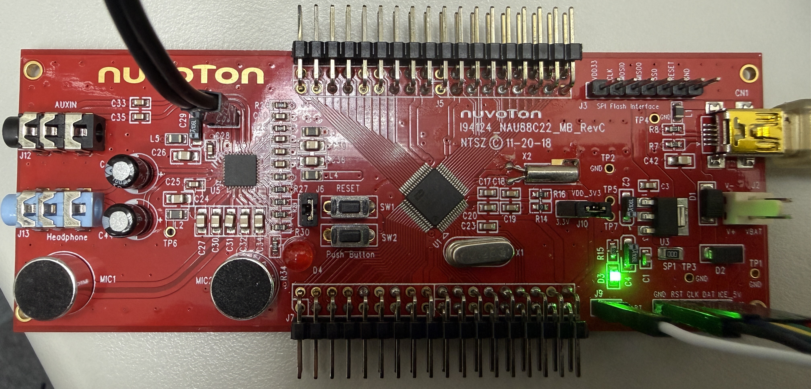
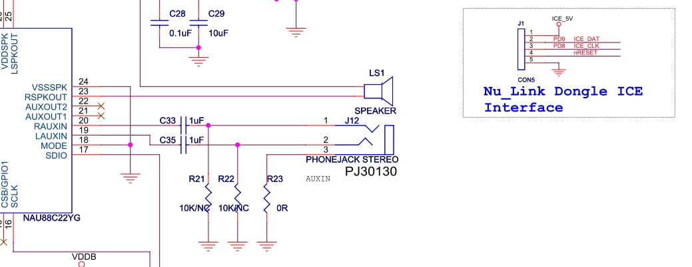
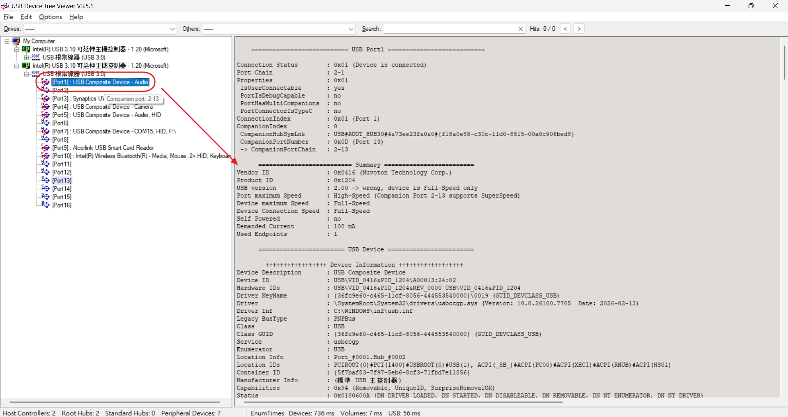
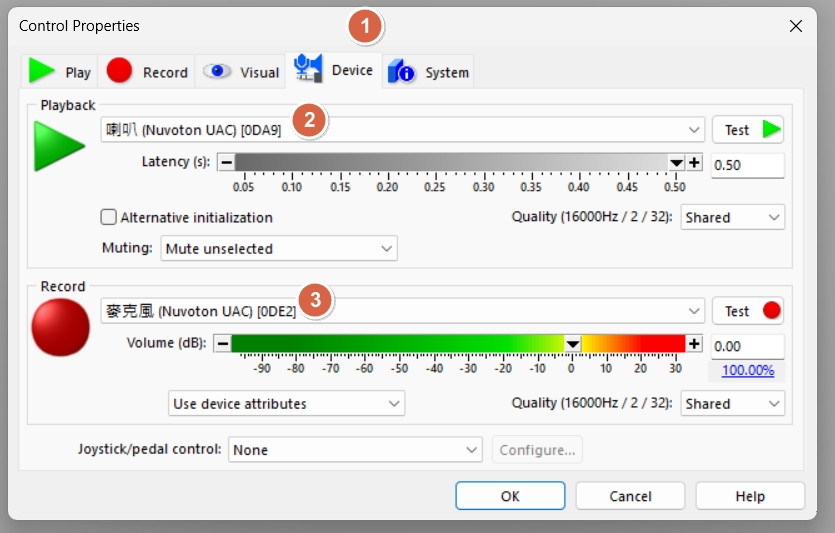
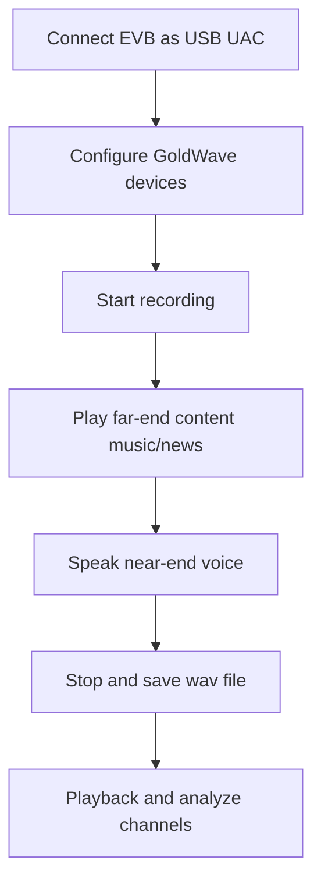
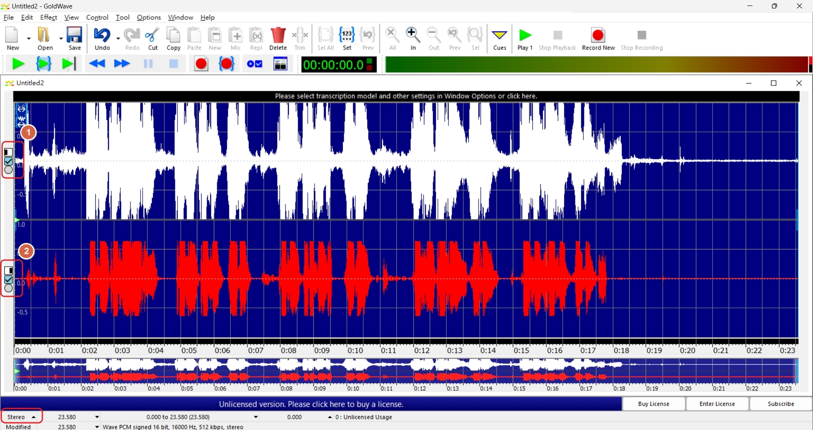
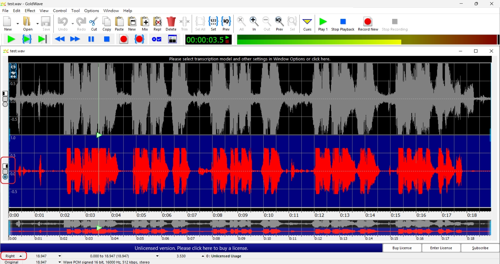

[回到知識庫總索引](https://released.github.io/)

# Nuvoton AEC / NR operation flow

> 這是一份雙語實驗指南，用來建立可重複的 USB Audio AEC / NR 錄音、回放與驗收流程。判讀條件包含一致的裝置列舉、聲道模式與測試音源。

## Content map

- The English section records setup, capture, playback, and troubleshooting.
- The Traditional Chinese section records the same workflow.
- Preserve the original recording files and settings when comparing AEC / NR on and off.

## Agenda

* Test objective and environment checklist
* USB audio device enumeration
* GoldWave recording settings
* AEC / NR operation and capture flow
* Playback analysis (Stereo / Mono channel behavior)
* Pass criteria and troubleshooting notes

---

## 1. Test objective and setup

### Test objective

* Verify that `AEC / NR` works correctly when EVB runs in USB UAC mode.
* Build a repeatable recording flow for before/after comparison.
* Avoid incorrect conclusions caused by channel settings (`AEC / NR` supports `MONO` only).

### Lab setup checklist

| Item | Value | Note |
|------|-------|------|
| EVB | `I94124_NAU88C22_MB_REVC` | Test board |
| FW | AEC / NR library + USB UAC enable | Firmware must enable the algorithm |
| Audio tool | GoldWave | Recording / playback / channel check |

* GoldWave release page: <https://goldwave.com/release.php>

---

## 2. USB connection and device check

1. Connect EVB to the PC through USB.
2. Confirm that the OS enumerates:
   * `Speaker Nuvoton UAC`
   * `Microphone Nuvoton UAC`
3. Confirm speaker and microphone paths are both active before recording.

> **Important**
> If `Speaker` and `Microphone` are not enumerated correctly, fix USB cable/driver/power issues first, then run AEC / NR tests.

---

## 3. GoldWave settings

In GoldWave, open `Control related properties > Devices` and set:

* `Playback Device` : `Speaker Nuvoton UAC`
* `Record Device` : `Microphone Nuvoton UAC`

This ensures both record and playback use the EVB audio path so AEC / NR behavior can be observed correctly.

---

## 4. AEC / NR recording flow

### Recording procedure

1. Start recording.
2. Play background content (music, speech, or news) to simulate far-end audio.
3. Add near-end speech at the same time and observe echo/noise suppression in the recorded file.
4. Stop recording and save the WAV file.

---

## 5. Sample files and playback interpretation

### Sample files

| File | Content | Usage |
|------|---------|------|
| [test1.wav](img/test1.wav) | Music (English) | Background-audio scenario |
| [test2.wav](img/test2.wav) | News broadcast | Speech-interference scenario |
| [test3.wav](img/test3.wav) | Music (Chinese) | Mixed-content scenario |

### Playback observation

1. In default `Stereo` playback, background audio and voice can both be heard.
2. When switched to right channel (`AEC / NR` supports `MONO` only), voice content should be dominant.
3. Use channel switching to verify whether the algorithm output path matches expectation.

---

## 6. Validation points and troubleshooting

| Symptom | Possible cause | Action |
|------|------|------|
| No recorded audio | Wrong record device | Re-select `Microphone Nuvoton UAC` |
| No playback audio | Wrong playback device | Re-select `Speaker Nuvoton UAC` |
| Weak AEC effect | Far-end level too low / unstable mic distance | Increase background level and keep fixed mic distance |
| Listening result does not match expectation | Using Stereo result to judge MONO algorithm | Switch channel first, then compare |

> **Validation note**
> Keep test conditions fixed (volume, distance, noise source) to compare AEC / NR performance across firmware versions fairly.

---

## 7. Summary

* Complete USB UAC enumeration and GoldWave device binding before test.
* Inject both far-end and near-end signals during recording to validate AEC / NR.
* Account for `MONO` support limitation during playback analysis.
* Keep one fixed sample set for regression comparison across firmware versions.

[back to top](#article_top)

---

# Nuvoton AEC / NR 操作流程

## 議程

* 測試目標與環境檢查
* USB 音訊裝置列舉確認
* GoldWave 錄音設定
* AEC / NR 操作與錄製流程
* 回放分析（Stereo / Mono 聲道行為）
* 驗收條件與除錯資訊

---

## 1. 測試目標與環境

### 測試目標

* 驗證 EVB 在 USB UAC 模式下，`AEC / NR` 是否可正常運作。
* 建立可重現的錄音流程，便於比較啟用前後差異。
* 避免因聲道設定造成誤判（`AEC / NR` 僅支援 `MONO`）。

### 實驗室環境檢查表

| 項目 | 設定值 | 說明 |
|------|-------|------|
| EVB | `I94124_NAU88C22_MB_REVC` | 測試板 |
| FW | AEC / NR library + USB UAC enable | 韌體需啟用演算法 |
| 音訊工具 | GoldWave | 錄音 / 回放 / 聲道檢查 |

* GoldWave 下載頁：<https://goldwave.com/release.php>

---

## 2. USB 連線與裝置確認

1. 使用 USB 將 EVB 連接到 PC。
2. 確認作業系統已列舉出：
   * `Speaker Nuvoton UAC`
   * `Microphone Nuvoton UAC`
3. 確認喇叭與麥克風路徑都可正常使用，再進行錄音。

> **Important**
> 若 `Speaker` 與 `Microphone` 未正確列舉，可由 USB 線材、驅動與供電狀態開始排查；裝置列舉正常後再進行 AEC / NR 測試。

---

## 3. GoldWave 設定

在 GoldWave 開啟 `Control related properties > Devices`，設定如下：

* `Playback Device` : `Speaker Nuvoton UAC`
* `Record Device` : `Microphone Nuvoton UAC`

此設定可確保錄音與回放都走 EVB 音訊路徑，才能正確觀察 AEC / NR 行為。

---

## 4. AEC / NR 錄音流程

### 錄音步驟

1. 開始錄音。
2. 播放背景內容（音樂、語音或新聞）模擬 far-end 音訊。
3. 同時加入 near-end 人聲，觀察錄音檔中的回音/噪音抑制效果。
4. 停止錄音並儲存 WAV 檔。

---

## 5. 測試檔案與回放判讀

### 測試檔案

| 檔案 | 內容 | 用途 |
|------|------|------|
| [test1.wav](img/test1.wav) | 音樂（英文） | 背景音情境測試 |
| [test2.wav](img/test2.wav) | 新聞播報 | 語音干擾情境測試 |
| [test3.wav](img/test3.wav) | 音樂（中文） | 混合內容情境測試 |

### 回放觀察重點

1. 預設 `Stereo` 回放時，通常可同時聽到背景音與人聲。
2. 切到右聲道時（`AEC / NR` 僅支援 `MONO`），人聲會較為明顯。
3. 透過聲道切換，確認演算法輸出路徑是否符合預期。

---

## 6. 驗收重點與除錯資訊

| 現象 | 可能原因 | 處理方式 |
|------|----------|----------|
| 錄不到聲音 | 錄音裝置選錯 | 重新選擇 `Microphone Nuvoton UAC` |
| 回放無聲 | 播放裝置選錯 | 重新選擇 `Speaker Nuvoton UAC` |
| AEC 效果不明顯 | far-end 音量太小 / 麥克風距離不穩定 | 提高背景音量並固定收音距離 |
| 聽感與預期不一致 | 用 Stereo 結果判讀 MONO 演算法 | 先切換聲道再比較 |

> **Validation note**
> 不同韌體版本的 AEC / NR 表現，需要在相同音量、距離與噪音來源等測試條件下比較。

---

## 7. Summary

* 測試前先完成 USB UAC 列舉與 GoldWave 裝置綁定。
* 錄音時同時注入 far-end 與 near-end 訊號，才能有效驗證 AEC / NR。
* 回放分析需考慮 `MONO` 支援限制，避免聲道誤判。
* 固定測試樣本可作為韌體版本回歸比較基準。

[back to Chinese top](#article_top_zh)
